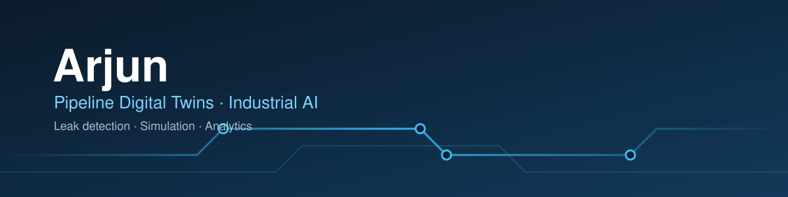

  

### Project engineer building pipeline digital twins for oil and gas

---

🔭 I'm currently working on **pipeline digital twins** (leak detection, operator training simulators, pipeline monitoring and analysis) and **industrial AI/ML applications**

🌱 I'm currently exploring **local small language models and RAG for internal enterprise use**

👯 I'm looking to collaborate on **pipeline simulation, leak detection and industrial AI**

💬 Ask me about **Pipeline modelling | Leak detection | OPC UA integration | DeltaV PipelineManager | Anomaly detection**

📫 How to reach me: **YOUR-EMAIL**

⚡ Fun fact: **WRITE YOUR OWN HERE**

## Connect with me

## Tools

